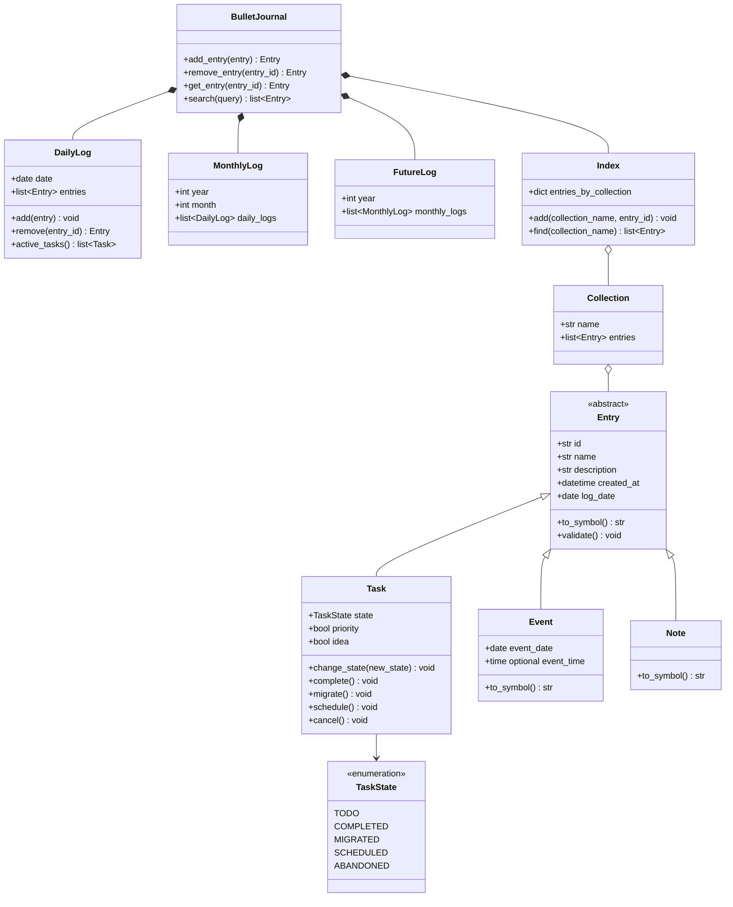

# Bullet Journal Python

Bibliotheque Python sans interface graphique pour gerer les entrees d'un Bullet
Journal, leur organisation et leur cycle de vie. Le projet vise d'abord le
niveau 1 complet et propre, puis les niveaux 2 et 3.

Ce README presente d'abord le **modele objet**, les transitions, l'arborescence,
les exceptions et le plan de travail demandes a l'etape 1. Le code sera ajoute
aux etapes suivantes.

## 1. Modele objet

### Diagramme de classes



### Role des classes

- `Entry` est la classe de base abstraite commune aux trois types. Elle contient
  les informations exigees : identifiant, nom, description, date de creation et
  date du log. `to_symbol()` est abstraite pour imposer le symbole propre a
  chaque type.
- `Task` represente une tache. Elle utilise une enumeration `TaskState` pour
  eviter les chaines libres comme `"en cours"` ou `"terminee"`. Elle contient
  aussi les signifiants `priority` pour `*` et `idea` pour `!`.
- `Event` represente un evenement. Il peut avoir une date et une heure
  facultative.
- `Note` represente une note et ne suit pas le cycle de vie d'une tache.
- `BulletJournal` est le point d'entree principal. Il regroupe les logs et
  delegue les operations specialises aux classes adaptees.
- `DailyLog`, `MonthlyLog` et `FutureLog` organisent les entrees dans le temps.
- `Index` et `Collection` permettent de retrouver les entrees par collection.

### Choix importants

- Chaque entree recoit un identifiant unique avec `uuid.uuid4()`. Deux entrees
  peuvent donc avoir le meme nom sans etre confondues.
- Les dates sont conservees sous forme d'objet `date` ou `datetime`. Une date
  brute sous forme de texte est convertie a l'entree dans le journal.
- Le nom est obligatoire. Un nom compose uniquement d'espaces est refuse.
- La date de creation est automatique. La date du log est celle du log auquel
  l'entree appartient.
- Les transitions sont centralisees dans `Task.change_state()`. Cela garantit
  qu'aucune autre methode ne puisse changer l'etat directement sans controle.
- Chaque methode peut exposer une methode pratique comme `complete()`, mais
  celle-ci appelle toujours `change_state()` pour appliquer les memes regles.

## 2. Symboles et transitions

### Symboles

| Element | Symbole |
|---|---|
| Tache | `•` |
| Evenement | `○` |
| Note | `–` |
| Terminee | `×` |
| Migree | `>` |
| Planifiee | `<` |
| Abandonnee | aucune represente par l'etat ou son symbole non standard |
| Priorite | `*` |
| Idee | `!` |

Affichage exemple : `* • Acheter des fournitures — preparer les fournitures`

### Etas autorises pour une tache

| Etat actuel | Vers TODO | Vers COMPLETED | Vers MIGRATED | Vers SCHEDULED | Vers ABANDONED |
|---|---|---|---|---|---|
| TODO | autorise | autorise | autorise | autorise | autorise |
| COMPLETED | interdit | autorise | interdit | interdit | interdit |
| MIGRATED | autorise | autorise | autorise | interdit | autorise |
| SCHEDULED | autorise | autorise | autorise | autorise | autorise |
| ABANDONED | interdit | interdit | interdit | interdit | autorise |

### Pourquoi certaines transitions sont interdites

- Une tache terminee ne peut pas etre remise en attente ou migree : terminer
  est une finalisation historique.
- Une tache abandonnee ne peut ni etre terminee, ni migree, ni planifiee.
- Une tache migree peut etre terminee dans son nouveau log ou remise a faire,
  mais pas planifiee directement puisqu'elle represente deja une migration.
- Une tache planifiee peut revenir a faire, etre terminee, migree ou abandonnee.

### Evenements et notes

Les evenements et les notes n'ont pas de `TaskState` :

| Operation | Evenement | Note |
|---|---|---|
| Ajouter | autorise | autorise |
| Supprimer | autorise | autorise |
| Modifier | autorise | autorise |
| Migrer | interdit : appeler une migration est une operation de tache | interdit |
| Planifier | interdit : un evenement a sa propre date | interdit |
| Abandonner | interdit : le contexte n'a pas de sens | interdit |
| Terminer | interdit : un evenement n'est pas execute | interdit |

Une tentative de migration d'une note ou d'un evenement doit lever
`InvalidStateTransitionError`.

## 3. Arborescence complete prevue

```text
projet_python_cy/
|-- README.md                 Documentation principale et guide d'utilisation
|-- requirements.txt          Dependances de l'environnement Python
|-- environment.yml           Environnement reproductible pour Anaconda
|-- pyproject.toml            Configuration des tests, du formatage et du package
|-- .gitignore                Fichiers locaux ou generes a ne pas publier
|-- LICENSE                   Conditions de reutilisation du projet
|-- src/
|   `-- bullet_journal/
|       |-- __init__.py       Expose l'API publique du paquet
|       |-- exceptions.py     Exceptions personnalisees
|       |-- models/
|       |   |-- __init__.py
|       |   |-- entry.py      Classe abstraite Entry
|       |   |-- task.py       Classe Task
|       |   |-- event.py      Classe Event
|       |   |-- note.py       Classe Note
|       |   `-- state.py      Enumeration TaskState
|       |-- journal/
|       |   |-- __init__.py
|       |   |-- journal.py    Point d'entree BulletJournal
|       |   |-- daily.py      DailyLog
|       |   |-- monthly.py    MonthlyLog
|       |   |-- future.py     FutureLog
|       |   |-- index.py      Index des collections
|       |   `-- collection.py Collection personnalisee
|       |-- services/
|       |   |-- __init__.py
|       |   `-- migration.py  Migration des taches entre deux logs
|       |-- persistence/
|       |   |-- __init__.py
|       |   `-- json_storage.py Sauvegarde et chargement JSON
|       |-- rendering/
|       |   |-- __init__.py
|       |   |-- console.py    Affichage avec les symboles
|       |   `-- markdown.py   Export Markdown
|       `-- logging_config.py Configuration des fichiers de logs
|-- tests/
|   |-- conftest.py            Fixtures pytest communes
|   |-- test_models.py         Tests des entrees
|   |-- test_task_lifecycle.py Tests des transitions
|   |-- test_migration.py      Tests des migrations
|   |-- test_journal.py        Tests des logs et collections
|   |-- test_persistence.py    Tests JSON
|   `-- test_rendering.py      Tests d'affichage et Markdown
|-- docs/
|   |-- conf.py                Configuration Sphinx
|   |-- index.rst              Page principale de la documentation
|   `-- api.rst                Documentation de l'API
|-- examples/
|   `-- basic_usage.py         Exemple utilisable hors interface
`-- .github/
    `-- workflows/
        `-- ci.yml             Verification PEP 8, docstrings et tests
```

Les dossiers `src/` utilisent un layout de paquet classique. Le code d'une
application importable est separe des tests et de la documentation.

## 4. Exceptions personnalisees

Toutes les exceptions doivent heriter de `BulletJournalError`, elles forment
ainsi une famille facile a intercepter.

| Exception | Quand elle est levee |
|---|---|
| `BulletJournalError` | Erreur generale de la bibliotheque, classe de base |
| `EntryNotFoundError` | Aucun identifiant ne correspond dans le journal |
| `EmptyNameError` | Le nom est absent, vide ou compose uniquement d'espaces |
| `InvalidDateError` | Une date est incoherente ou ne peut pas etre convertie |
| `InvalidStateTransitionError` | Une tache tente une transition interdite |
| `InvalidEntryTypeError` | Une operation propre aux taches est appelee sur une note ou un evenement |
| `DuplicateCollectionError` | Une collection portant deja ce nom est creee |
| `CollectionNotFoundError` | Une collection demandee n'existe pas |
| `PersistenceError` | Le fichier JSON ne peut pas etre lu ou ecrit |

## 5. Plan de travail en 10 etapes

Hypothese : l'equipe comporte deux personnes. Chaque personne travaille sur une
branche separee. Les parties communes doivent etre petites et fusionnees via une
Pull Request avant la suite.

| Etape | Travail | Branche proposee | Personne A | Personne B |
|---|---|---|---|---|
| 1 | Initialiser le depot, README, configuration et conventions | `setup/project` | Responsable | Revue |
| 2 | Creer les exceptions et les classes de base | `feature/models-base` | Responsable | Revue |
| 3 | Implementer Task, Event, Note et TaskState | `feature/entry-types` | Modele | Tests du modele |
| 4 | Implementer DailyLog, MonthlyLog et BulletJournal | `feature/journal` | Journal | Revue |
| 5 | Implementer les transitions et les tests du cycle de vie | `feature/task-lifecycle` | Responsable et revue croisee | Tests complets |
| 6 | Implementer la migration jour/mois | `feature/migration` | Partie journaliere | Partie mensuelle |
| 7 | Ajouter FutureLog, Index, collections et recherche | `feature/organization` | Organisation | Tests organisation |
| 8 | Ajouter JSON, Markdown, logs et exceptions de persistance | `feature/persistence-display` | Persistance | Affichage |
| 9 | Ajouter pytest, atteindre plus de 90 % de couverture et corriger les bugs | `test/coverage` | Tests metiers | Tests techniques |
| 10 | Configurer CI, Sphinx, README final et verification complete | `docs/finalization` | CI et docs | Revue globale |

### Organisation Git

- Une branche par fonctionnalite.
- Une Pull Request par branche, meme pour une petite equipe.
- Au moins une revue de l'autre membre avant la fusion.
- Ne jamais publier directement sur `main`.
- Fusionner les branches frequemment pour limiter les conflits.
- Ajouter un message clair, par exemple `feat: add task lifecycle`.

## 6. Initialisation de l'environnement

### Anaconda

```powershell
# Depuis le dossier du projet
conda create --name bullet-journal python=3.12 -y
conda activate bullet-journal
python -m pip install --upgrade pip
```

Pour installer les dependances apres leur creation :

```powershell
python -m pip install -r requirements.txt
```

### requirements.txt

La premiere version peut contenir les outils suivants :

```text
pytest
pytest-cov
flake8
flake8-docstrings
sphinx
build
twine
```

`flake8-docstrings` impose les docstrings. Les bibliotheques necessaires au
fonctionnement du modele devront rester nulles ou tres limitees afin de garder
la bibliotheque simple.

### Initialiser Git

Le depot est deja initialise dans ce projet. Pour reproduire l'initialisation
sur une autre machine :

```powershell
git init
git add README.md
git commit -m "Initial commit"
git branch -M main
git remote add origin https://github.com/RezzagYoussouf/bullet_journal.git
git push -u origin main
```

### Configurer .gitignore

Ajouter un fichier `.gitignore` avec au minimum :

```text
.venv/
venv/
env/
__pycache__/
*.py[cod]
.pytest_cache/
.coverage
htmlcov/
build/
dist/
*.egg-info/
.ipynb_checkpoints/
.sphinx/
docs/_build/
*.log
.vscode/
.idea/
```

## Prochaine etape

Une fois ce README valide, l'etape suivante sera la creation du squelette du
code : `pyproject.toml`, exceptions, classe abstraite `Entry`, enumeration
`TaskState`, puis les premieres classes `Task`, `Event` et `Note`. Nous ajouterons
egalement les premiers tests afin de verifier le modele avant les logs et la
persistance.
